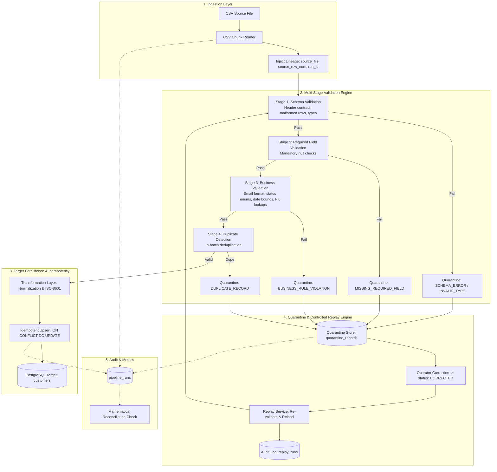
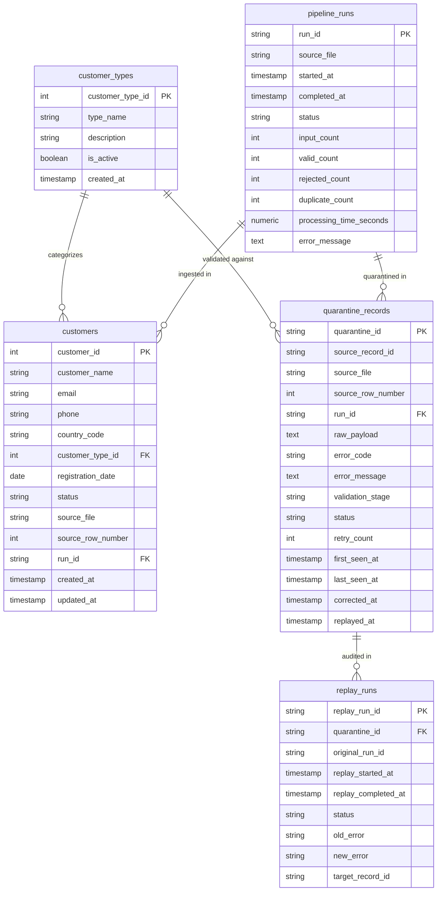
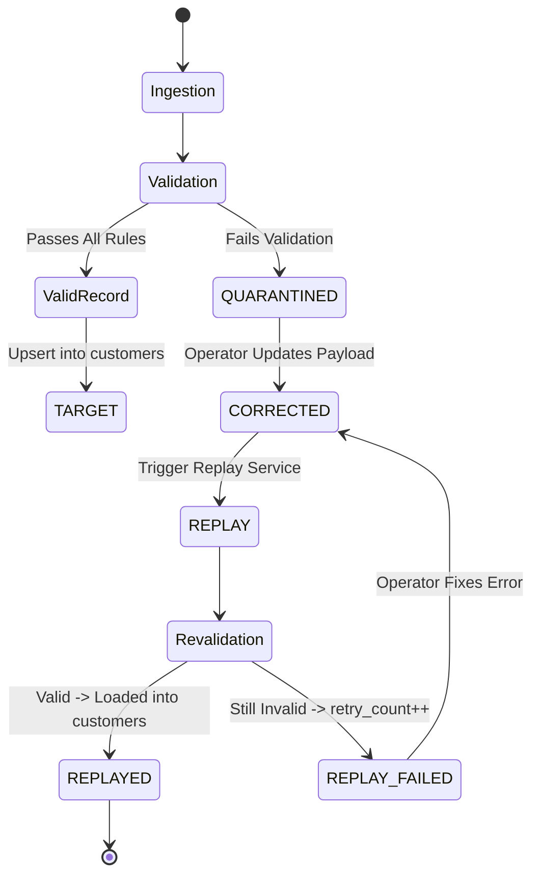

# Data Quality, Quarantine & Controlled Replay Pipeline

[](https://www.python.org/)
[]()
[]()
[]()

Production-style Data Quality (DQ), Quarantine, and Controlled Replay Pipeline built for robust batch ingestion from CSV sources into PostgreSQL with zero data loss, lossless error tracking, and rerun idempotency.

---

## 1. Project Overview

In real-world data engineering, upstream data feeds frequently arrive with schema mutations, missing values, corrupt strings, and business rule violations. Dropping invalid records silently results in data leakage, while crashing the pipeline halts downstream operations.

This project delivers an enterprise-grade vertical slice:
1. **Ingests** source records from CSV with streaming batch chunking.
2. **Validates** schema, required attributes, data types, and business rules across distinct validation stages.
3. **Isolates** invalid records directly into a dedicated PostgreSQL quarantine table, preserving 100% of the raw source payload and error reasons.
4. **Maintains Source Lineage** (`source_file`, `source_row_number`, `run_id`, timestamps).
5. **Loads** valid records idempotently into the target table (`customers`) using deterministic upsert logic (`ON CONFLICT DO UPDATE`).
6. **Enables Controlled Replay** of operator-corrected quarantine records with automatic revalidation, audit logging, and retry increments on repeated failures.
7. **Verifies Mathematical Reconciliation** (`Input = Valid + Rejected + Duplicates`).

---

## 2. Business Problem & Objectives

| Objective | Pipeline Implementation |
|---|---|
| **No Silent Drops** | All rejected records stored in `quarantine_records` with error codes. |
| **Full Traceability** | Lineage preserved: file name, row number, run UUID, raw payload. |
| **Controlled Replay** | Safe transition `QUARANTINED` $\rightarrow$ `CORRECTED` $\rightarrow$ `REPLAYED` / `REPLAY_FAILED`. |
| **Idempotency** | Running the same batch twice updates existing target rows with zero duplication. |
| **Observability** | Granular run metrics in `pipeline_runs` and replay audits in `replay_runs`. |
| **Scalability** | Constant-memory chunked streaming handling 100,000+ records in ~40 seconds. |

---

## 3. High-Level Architecture



---

## 4. Technology Stack

- **Language**: Python 3.11+ (tested on Python 3.13)
- **Database**: PostgreSQL 16 (production/docker) & SQLite (zero-setup local fallback)
- **Data Ingestion & Chunking**: Pandas
- **Schema Validation & Types**: Pydantic v2
- **ORM & Database Access**: SQLAlchemy 2.0+ & psycopg3 (binary)
- **Synthetic Data Generation**: Faker
- **Automated Testing**: pytest, pytest-cov
- **Configuration**: python-dotenv, PyYAML

---

## 5. Project Structure

```text
data-quality-pipeline/
├── README.md                      # Comprehensive documentation
├── requirements.txt               # Pinned Python dependencies
├── .env.example                   # Environment variable template
├── .gitignore                     # Git ignore rules
├── docker-compose.yml             # PostgreSQL 16 Docker service
├── pytest.ini                     # Pytest runner configuration
│
├── config/
│   └── config.yaml                # Application batch and validation rules
│
├── data/
│   ├── input/                     # Source CSV files (e.g. customers.csv)
│   ├── expected/                  # Ground truth test labels (isolated)
│   ├── output/                    # Pipeline run artifacts
│   └── quarantine/                # Exported quarantine dumps
│
├── sql/
│   ├── schema.sql                 # Target DDL, quarantine, and audit tables
│   ├── seed.sql                   # Reference table seed data
│   └── reconciliation.sql         # 8 audit and reconciliation verification queries
│
├── src/
│   ├── __init__.py
│   ├── config/
│   │   ├── __init__.py
│   │   └── settings.py            # Typed settings & environment loader
│   ├── ingestion/
│   │   ├── __init__.py
│   │   └── csv_reader.py          # Chunked streaming CSV reader with lineage
│   ├── validation/
│   │   ├── __init__.py
│   │   ├── models.py              # Error codes, QuarantineCandidate, ValidatedRecord
│   │   ├── schema_validator.py    # Schema & required field validator
│   │   ├── business_validator.py  # Business rules & referential integrity
│   │   └── duplicate_validator.py # Intra-batch duplicate detector
│   ├── transformation/
│   │   ├── __init__.py
│   │   └── transformer.py         # Canonical transformation & sanitization
│   ├── database/
│   │   ├── __init__.py
│   │   ├── connection.py          # Engine factory, session maker, init_db
│   │   ├── models.py              # SQLAlchemy 2.0 ORM models
│   │   └── repositories.py        # Customer, Quarantine, PipelineRun, ReplayRun repos
│   ├── quarantine/
│   │   ├── __init__.py
│   │   └── quarantine_service.py  # Quarantine lifecycle & correction service
│   ├── replay/
│   │   ├── __init__.py
│   │   └── replay_service.py      # Controlled replay coordinator
│   ├── monitoring/
│   │   ├── __init__.py
│   │   └── metrics.py             # Metrics tracker & reconciliation reporter
│   ├── pipeline/
│   │   ├── __init__.py
│   │   └── runner.py              # Pipeline execution orchestrator
│   └── main.py                    # Unified CLI (ingest, replay, reconcile)
│
├── generators/
│   ├── __init__.py
│   └── generate_data.py           # Deterministic synthetic data generator
│
├── benchmarks/
│   ├── __init__.py
│   └── run_benchmark.py           # Scale benchmark runner (1K, 10K, 100K)
│
└── tests/
    ├── conftest.py                # Isolated in-memory DB fixtures
    ├── test_ingestion.py          # CSV chunking, empty files, lineage
    ├── test_validation.py         # Schema, types, business rules, FKs
    ├── test_duplicates.py         # Intra-batch duplicate detection
    ├── test_quarantine.py         # Storage, payload preservation, correction
    ├── test_replay.py             # Replay success & retry-increment failure
    ├── test_idempotency.py        # Rerun deduplication & target stability
    ├── test_pipeline.py           # End-to-end integration & reconciliation
    └── test_cli.py                # Command-line subcommands & config loading
```

---

## 6. Database Schema & Entity Relationships



---

## 7. Data Dictionary (`customers.csv`)

| Column Name | Type | Nullable | Validation Rule | Business Meaning |
|---|---|---|---|---|
| `customer_id` | Integer | No | Strictly positive integer (`> 0`) | Unique customer identifier |
| `customer_name` | String | No | Length 1-100, non-blank | Full name of customer |
| `email` | String | No | RFC 5322 regex validation | Primary contact email address |
| `phone` | String | Yes | E.164 optional format or standard phone chars | Customer telephone number |
| `country_code` | String | Yes | ISO 3166-1 alpha-2 uppercase string | Country of residence |
| `customer_type_id` | Integer | No | Must exist in `customer_types` reference table | Customer tier / segment |
| `registration_date` | Date | No | Format `YYYY-MM-DD`, cannot be in future | Initial account registration date |
| `status` | String | No | Enum: `['ACTIVE', 'INACTIVE', 'SUSPENDED']` | Current account status |
| `updated_at` | Timestamp | Yes | ISO-8601 (`YYYY-MM-DD HH:MM:SS`) | Source modification timestamp |

---

## 8. Validation Rules & Standardized Error Codes

| Error Code | Stage | Validation Check | Action on Replay |
|---|---|---|---|
| `SCHEMA_MISSING_COLUMN` | `SchemaValidation` | Required CSV column missing from file header | Fix file header |
| `SCHEMA_UNEXPECTED_COLUMN` | `SchemaValidation` | Extra unmapped column found in file header | Strip unexpected columns |
| `MALFORMED_RECORD` | `SchemaValidation` | Date parsing error or CSV format corruption | Correct string format |
| `MISSING_REQUIRED_FIELD` | `RequiredFieldValidation` | Mandatory column is null, empty string, or `"NULL"` | Provide field value |
| `INVALID_DATA_TYPE` | `SchemaValidation` | Integer field cannot be parsed (e.g. non-numeric ID) | Cast/clean data type |
| `INVALID_CUSTOMER_ID` | `BusinessValidation` | `customer_id <= 0` | Assign positive ID |
| `INVALID_EMAIL` | `BusinessValidation` | Syntax does not match `^[a-zA-Z0-9_.+-]+@[a-zA-Z0-9-]+\.[a-zA-Z0-9-.]+$` | Fix email syntax |
| `INVALID_STATUS` | `BusinessValidation` | Status not in `ACTIVE`, `INACTIVE`, `SUSPENDED` | Map to valid enum |
| `FUTURE_DATE` | `BusinessValidation` | `registration_date > date.today()` | Correct date |
| `INVALID_REFERENCE` | `BusinessValidation` | `customer_type_id` not found in `customer_types` table | Assign existing type ID |
| `DUPLICATE_RECORD` | `DuplicateValidation` | Multiple rows in same file share identical `customer_id` | Deduplicate upstream |
| `TRANSFORMATION_ERROR` | `Transformation` | Unhandled error during cleansing/normalization | Update transform rule |
| `DATABASE_ERROR` | `Persistence` | Database constraint violation or connection loss | Retry with backoff |

---

## 9. Quarantine & Replay Workflow



### Quarantine State Machine:
1. **`QUARANTINED`**: Initial state upon ingestion rejection. Complete payload stored as JSON with primary error code, concatenated messages, and source lineage.
2. **`CORRECTED`**: An operator or automated remediation script corrects the invalid values in the raw payload via `quarantine_service.correct_record()`.
3. **`REPLAYED`**: Replay runner re-validates the payload through the full validation engine. If valid, the customer is idempotently loaded into `customers`, quarantine status is set to `REPLAYED`, and an audit row is written to `replay_runs`.
4. **`REPLAY_FAILED`**: If the corrected payload still fails any rule, `retry_count` is incremented, error code is updated, and an audit row is written to `replay_runs`.

---

## 10. Idempotency & Rerun Strategy

The pipeline is strictly idempotent:
- **Primary Key Stability**: `customer_id` serves as the deterministic primary key.
- **Upsert Engine (`ON CONFLICT DO UPDATE`)**:
  ```sql
  INSERT INTO customers (...) VALUES (...)
  ON CONFLICT (customer_id) DO UPDATE SET
      customer_name = EXCLUDED.customer_name,
      email = EXCLUDED.email,
      phone = EXCLUDED.phone,
      country_code = EXCLUDED.country_code,
      customer_type_id = EXCLUDED.customer_type_id,
      registration_date = EXCLUDED.registration_date,
      status = EXCLUDED.status,
      source_file = EXCLUDED.source_file,
      source_row_number = EXCLUDED.source_row_number,
      run_id = EXCLUDED.run_id,
      updated_at = EXCLUDED.updated_at;
  ```
- **Rerun Verification**: Executing the pipeline twice on the same input file results in `target_inserted_count = 0` and `target_updated_count = N` with 0 duplicate rows created.

---

## 11. Setup & Execution Instructions

### 11.1 Prerequisites
- Python 3.11+
- Docker & Docker Compose (optional, for PostgreSQL service)

### 11.2 Environment Setup
```bash
# Clone repository
git clone https://github.com/your-org/data-quality-pipeline.git
cd data-quality-pipeline

# Create virtual environment
python -m venv venv
source venv/bin/activate  # On Windows: .\venv\Scripts\activate

# Install dependencies
pip install -r requirements.txt

# Copy environment file
cp .env.example .env
```

### 11.3 Database Setup (PostgreSQL with Docker)
```bash
# Start PostgreSQL container
docker compose up -d

# Verify PostgreSQL is ready
docker compose ps
```
*Note: If PostgreSQL is not running, the pipeline automatically supports SQLite fallback for local development by setting `DATABASE_URL=sqlite:///./data_pipeline.db` in `.env` or passing `--db-url`.*

---

## 12. CLI Commands & Operational Workflow

### Generate Synthetic Test Data
```bash
# Generate 1,000 sample records (deterministic seed 42)
python -m generators.generate_data --rows 1000 --seed 42

# Generate 100,000 records for performance testing
python -m generators.generate_data --rows 100000 --seed 42
```

### Run Ingestion Pipeline
```bash
# Run pipeline against input CSV
python -m src.main ingest --input data/input/customers.csv

# Run with custom batch size or database URL
python -m src.main ingest --input data/input/customers.csv --batch-size 2500 --db-url sqlite:///./data_pipeline.db
```

### Run Controlled Replay
```bash
# Replay eligible CORRECTED records
python -m src.main replay --limit 500
```

### Run Database Reconciliation Audit
```bash
# Check target counts, quarantine breakdown, and orphan keys
python -m src.main reconcile
```

---

## 13. Automated Tests & Test Coverage

Execute the comprehensive pytest test suite:
```bash
# Run all tests
pytest

# Run tests with test coverage analysis
pytest --cov=src --cov-report=term-missing
```

### Actual Test Coverage Results (91% overall coverage):
```text
Name                                    Stmts   Miss  Cover   Missing
---------------------------------------------------------------------
src\__init__.py                             1      0   100%
src\config\__init__.py                      2      0   100%
src\config\settings.py                     71      2    97%   103-105
src\database\__init__.py                    3      0   100%
src\database\connection.py                 67      9    87%   26, 42-43, 58, 67, 73, 86-88
src\database\models.py                     85      5    94%   46, 84, 124, 147, 177
src\database\repositories.py              106     16    85%   36, 47, 93-98, 108-110, 124, 171-177
src\ingestion\__init__.py                   2      0   100%
src\ingestion\csv_reader.py                56      7    88%   51, 105-110
src\main.py                                90     10    89%   31-32, 90, 110-111, 164-165, 174-175, 179
src\monitoring\__init__.py                  2      0   100%
src\monitoring\metrics.py                  70      2    97%   77, 120
src\pipeline\__init__.py                    2      0   100%
src\pipeline\runner.py                     93      9    90%   110, 131-138
src\quarantine\__init__.py                  2      0   100%
src\quarantine\quarantine_service.py       40      5    88%   28, 48-49, 53-54
src\replay\__init__.py                      2      0   100%
src\replay\replay_service.py               96     13    86%   45-50, 98-106, 116-124, 142-150
src\transformation\__init__.py              2      0   100%
src\transformation\transformer.py          33      3    91%   83-85
src\validation\__init__.py                  5      0   100%
src\validation\business_validator.py       37      0   100%
src\validation\duplicate_validator.py      25      0   100%
src\validation\models.py                   51      0   100%
src\validation\schema_validator.py         78      9    88%   126-127, 140-141, 157-161
---------------------------------------------------------------------
TOTAL                                    1021     90    91%
======================== 23 passed in 5.09s ========================
```

---

## 14. Performance Benchmarks

Run benchmark scale test across 1K, 10K, and 100K records:
```bash
python -m benchmarks.run_benchmark
```

### Actual Measured Results:
| Dataset Size | Wall Clock Time (s) | Throughput (records/sec) | Status |
|---|---|---|---|
| **1,000** | **0.5490 s** | **1,821.5 rec/s** | `PARTIAL_SUCCESS` |
| **10,000** | **3.6910 s** | **2,709.3 rec/s** | `PARTIAL_SUCCESS` |
| **100,000** | **41.9082 s** | **2,386.2 rec/s** | `PARTIAL_SUCCESS` |

### Architectural Optimizations Implemented:
1. **Chunked Streaming**: Streaming chunks via `pd.read_csv(chunksize=2500)` prevents high memory consumption on 100K+ files.
2. **Bulk Idempotent Upsert**: Translates batches into bulk `ON CONFLICT DO UPDATE` statements, eliminating row-by-row queries.
3. **In-Memory Referential Caching**: Pre-fetches valid `customer_type_ids` into a set cache, reducing database roundtrips from $O(N)$ to $O(1)$.
4. **Target & Quarantine Indexing**: B-tree indexes on `customers(email, run_id)` and `quarantine_records(status, error_code, run_id)`.

---

## 15. Reconciliation Results & Sample Run Report

### Sample Execution Output:
```text
============================================================
PIPELINE RUN REPORT
============================================================
Run ID              : RUN-20261112-175225-88D276
Source File         : customers.csv

Input Records       : 1000
Valid Records       : 920
  - Target Inserted : 920
  - Target Updated  : 0
Rejected Records    : 60
Duplicate Records   : 20

Processing Time     : 0.4747 seconds
Throughput          : 2106.7 records/sec
Status              : PARTIAL_SUCCESS

============================================================
QUARANTINE SUMMARY
============================================================
MISSING_REQUIRED_FIELD : 21
DUPLICATE_RECORD       : 20
INVALID_EMAIL          : 7
FUTURE_DATE            : 7
INVALID_STATUS         : 7
MALFORMED_RECORD       : 6
INVALID_CUSTOMER_ID    : 6
INVALID_REFERENCE      : 6

============================================================
RECONCILIATION
============================================================
Equation: Input = Valid + Rejected + Duplicate
1000 = 920 + 60 + 20
Result: PASS
============================================================
```

---

## 16. Design Trade-offs & Engineering Decisions

1. **Why Pandas for Ingestion?**
   - High-throughput C-based parsing, built-in chunking, and memory predictability for files up to several gigabytes.
2. **Why Pydantic v2 for Validation?**
   - Type coercion, granular error message generation, and field-level metadata without throwing unhandled exceptions.
3. **Why Quarantine Instead of Discarding Invalid Data?**
   - Preserves complete operational lineage, enables downstream auditability, and allows controlled replay after correction.
4. **Why Upsert (`ON CONFLICT`) vs Overwrite?**
   - Enables true idempotency during pipeline retries, network blips, or historical backfills without generating duplicate rows.
5. **Why Synthetic Deterministic Data?**
   - Enables reproducible testing with fixed seeds (`seed=42`) without security or PII compliance risks.
6. **Why Not Kafka / Airflow / Spark for this Assignment?**
   - Prioritizes a clean, easily runnable, zero-dependency vertical slice testable in local development within minutes.

---

## 17. Known Limitations & Future Improvements

- **Distributed Streaming**: Transition from single-node chunking to Apache Kafka or PySpark when data sizes exceed single-machine memory or require sub-second streaming.
- **Operator Web UI**: Implement a lightweight Streamlit or FastAPI dashboard for reviewing quarantined rows and applying one-click web corrections.
- **SCD Type 2 History**: Add `is_current`, `valid_from`, and `valid_to` columns to `customers` if business requires full temporal change tracking.
